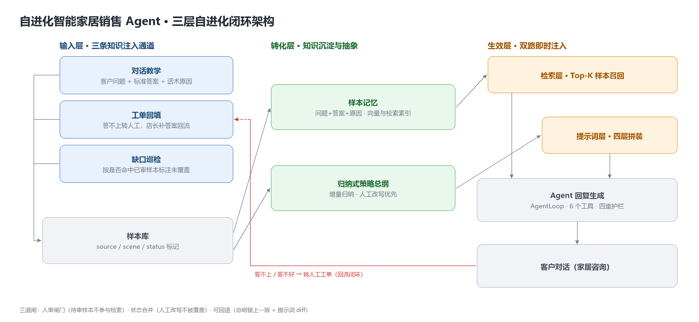

# 架构设计

> 这份文档讲**为什么这么设计**，主线是：**自进化是怎么实现的、怎么证明它真的发生了、又怎么防止它学歪**。
> 接口用法见 [API.md](./API.md)，需求与边界见 [需求清单.md](./需求清单.md)。

---

## 0. 一句话

> **一个会越用越准的销售 Agent：店长每教一句，可检索的样本、可注入的策略、可拒答的边界同时变厚 —— 不训练模型，改完下一句就生效。**

关键词是**同时**。只更新样本不更新策略，等于记了案例没学到方法；只更新策略不更新样本，换了问法就失效。

---

## 1. 先看闭环：进化是怎么转起来的



```
                    ┌──────────── 能力单调上升 ────────────┐
                    │                                     │
   ① 店长教一句                                        │
        │                                               │
        ▼                                               │
   ② 样本库 +1                                          │
      （客户问题 / 标准答案 / 为什么这么答）               │
        │                                               │
        ▼                                               │
   ③ 大模型归纳 → 策略总纲 +1 条                          │
      （增量：只喂新样本；人工改写作为基底，冲突以人工为准）  │
        │                                               │
        ▼                                               │
   ④ 下一轮动态拼进 system prompt                        │
        │                                               │
        ▼                                               │
   ⑤ 同一句话：教之前转人工 → 教之后直接答对  ───────────┘
        │
        └──▶ 答不上 / 答不好 → ⑥ 工单 → 回到 ①
```

**闭环有两个入口**（教学、工单）和**一个出口**（下一轮对话）。
出口没有变化，就说明进化没发生——这是整份文档的判断标准。

---

## 2. 「进化」到底体现在哪：四样东西同时变

这是本项目最该被验证的部分。教一句之后，系统里有 **4 处**内容发生变化：

| # | 变的是什么 | 变化内容 | 怎么当场验证 |
|---|---|---|---|
| 1 | **可检索的样本** | +1 条带向量的问答（问题/答案/原因） | `GET /api/playbook` |
| 2 | **可注入的策略** | 总纲多一条通用原则 | `GET /api/summary` 的 `added` 数组 |
| 3 | **喂给模型的提示词** | system prompt 多一段 | `GET /api/settings/system-prompt` 能搜到关键词 |
| 4 | **拒答边界** | 原本 `handoff` 的问题，现在能答 | 同一句话前后对比 `handoff` 字段 |

### 验收脚本（4 步，2 分钟）

```bash
B=http://127.0.0.1:8100

# ① 教之前：问一句没学过的 → 转人工
curl -s -X POST $B/api/chat -H 'Content-Type: application/json' \
  -d '{"message":"你们能改燃气管道吗？","session_id":"v1"}' | grep -o '"handoff":[a-z]*'
#   → "handoff":true      ← 边界在这里

# ② 教一句 → 进待审；再问 → 仍然转人工
curl -s -X POST $B/api/tickets/<id>/teach -H 'Content-Type: application/json' \
  -d '{"answer":"...","note":"..."}'
curl -s -X POST $B/api/chat -H 'Content-Type: application/json' \
  -d '{"message":"你们能改燃气管道吗？","session_id":"v2"}' | grep -o '"handoff":[a-z]*'
#   → "handoff":true      ← 闸门生效：没审核就不算学会

# ③ 审核通过 → 看总纲多了什么
curl -s -X POST $B/api/playbook/<id>/approve | python -m json.tool
#   → "summary_changed": true, "added": ["13. 涉及燃气安全一律不承诺能改……"]

# ④ 再问 → 边界移动了
curl -s -X POST $B/api/chat -H 'Content-Type: application/json' \
  -d '{"message":"你们能改燃气管道吗？","session_id":"v3"}' | grep -o '"handoff":[a-z]*'
#   → "handoff":false     ← 同一个问题，从"拒答"变成"能答"
```

**第 ② 步是最容易被忽略、但最能说明问题的一步**：
教了但没审核，系统**故意**不生效。进化不是"自动吸收一切"，而是"经过确认才吸收"。

---

## 3. 三根柱子：支撑进化的三个前提

不是三个并列的技术点，是**缺一个进化就转不起来**：

| 柱子 | 缺了它会怎样 | 在本项目里 |
|---|---|---|
| **Agent Loop** | **用不上**——学到的样本躺在库里，没有"该查时去查"的机制 | 模型自主决定何时调 `recall_playbook`、何时转人工 |
| **示范学习** | **学不进**——只能靠人手改代码里的提示词，业务方改不动 | 教学/工单 → 待审 → 归纳 → 注入，全程无需改代码 |
| **约束前置** | **学坏**——教一句错的，等于把风险装进系统 | 报价红线在数据结构层面就不存在；硬承诺拦截 |

---

## 4. 和另外两种做法的对比

| 做法 | 生效速度 | 可否回退 | 能力上限 | 可解释性 |
|---|---|---|---|---|
| 手写提示词 | 改代码 → 重启 | 可以（改回去） | 受人的表达能力 | 高 |
| 微调模型 | 数小时 ~ 数天 | 难（要重训） | 高 | 低（说不清学了啥） |
| **本方案：示范学习** | **下一句话** | **按条回退** | 受上下文长度限制 | **高**（每条样本可追溯） |

选它不是因为上限最高，是因为**业务话术一周一变，只有"当场改、当场生效"活得下去**。

---

## 5. 进化安全：怎么防止"越学越坏"

自进化真正的风险不是学不会，是**学歪**——一句错话被固化、一次归纳把人工规则冲掉、样本越积越乱。

| 闸 | 拦什么 | 实现 |
|---|---|---|
| **人审闸门** | 未确认的样本不许上线 | `WHERE status='approved'` 硬过滤，待审样本检索不到 |
| **状态合并** | AI 归纳不许覆盖人工修订 | 重归纳时把人工版作为基底传入，prompt 里写明"冲突以人工为准" |
| **可回退** | 出问题能退回上一个状态 | 总纲保留上一版 + 提示词 diff + 样本可驳回/删除 |

**这三道闸才是"进化"和"漂移"的分界线。** 没有它们，系统会越学越像自己（回声室），而不是越学越像那个最会卖的人。

---

## 6. 分层

```
┌─────────────────────────────────────────────────────────┐
│  接口层  FastAPI（19 个路由）                              │
│  对话 / 教学 / 审核 / 总纲 / 工单 / 看板                    │
├─────────────────────────────────────────────────────────┤
│  编排层  chat_service                                     │
│  每轮重建提示词 → 驱动 Loop → 合规兜底 → 记账              │
├─────────────────────────────────────────────────────────┤
│  智能层  AgentLoop（while 循环）                           │
│  ┌──────────────────────────────────────────────┐        │
│  │ 模型决策 → 调工具 → 观察结果 → 再决策 → 收尾    │        │
│  └──────────────────────────────────────────────┘        │
│         ↑ 6 个工具          ↑ 4 重护栏                     │
├─────────────────────────────────────────────────────────┤
│  知识层  样本库（检索） + 套路总纲（注入）                  │
├─────────────────────────────────────────────────────────┤
│  模型层  LLMProvider 抽象                                  │
│  OpenAI 兼容（DeepSeek/豆包） | 离线桩（mock）             │
└─────────────────────────────────────────────────────────┘
```

**关键：智能层只依赖抽象，不依赖具体模型或工具。**
换模型只需实现一个 `chat()`；加能力只需登记一个 `Tool`。

---

## 7. Agent Loop：一个 while 循环承担全部控制流

### 2.1 循环体

```python
while step < MAX_LOOP_STEPS:
    if 超时: 降级转人工; break

    trace.append(llm_call)              # 记录喂给模型的完整上下文
    decision = llm.chat(messages, tools) # 模型二选一
    trace.append(llm_response)

    if decision.type == "final":
        break                            # 收尾

    for call in decision.tool_calls:     # 可并行多个
        result = tool.run(...)           # 异常也转成 result
        messages.append(tool_result)     # 回填观察
```

### 2.2 四个设计决定

| 决定 | 替代方案 | 为什么选它 |
|---|---|---|
| **while 循环 + 模型决策** | 意图分类 + 路由表 | 新增场景不用改控制流；意图识别**隐式融进工具选择** |
| **工具异常转 observation** | 抛异常 / 重试 | 一次工具失败不该毁掉整轮对话，让模型自己纠正 |
| **标准 tool_call 消息结构** | 自造协议 | 换模型时适配层近零成本 |
| **全链路 trace** | 只打日志 | 能回答"模型当时看到了什么、为什么这么决定" |

### 2.3 四重护栏

模型自主 ≠ 放任。四条独立的闸门，任一条都能兜住：

| # | 护栏 | 位置 | 触发后 |
|---|---|---|---|
| 1 | 最大步数 8 | `loop.py` | 收尾 + 转人工 |
| 2 | 超时 45s | `loop.py` | 收尾 + 转人工 |
| 3 | **重复调用**（同工具同参数 > 2 次） | `loop.py` | 不再执行，回填 `duplicate` 错误 |
| 4 | **打转提前收尾**（连续 2 次重复） | `loop.py` | 直接结束，不烧完步数 |

护栏 3/4 是针对真实模型的：模型会卡在"我再查一次"，没有它就会烧光 8 次调用、留下一堆垃圾轨迹。

> 有单元测试：`_test_guard.py` 用一个"永远返回同一工具调用"的假模型验证收敛。

---

## 8. 工具层：能力即接口

6 个工具，共同遵守三条约定：

1. `name / description / parameters` 暴露给模型做 function calling
2. `run(**kwargs)` 返回结构化 dict；**失败返回 `{"error": ...}` 而不是抛异常**
3. 签名带 `**kwargs`（Loop 会注入 `session_id`，工具用它读写客户档案）

| 工具 | 作用 | 设计要点 |
|---|---|---|
| `recall_playbook` | 取回相似话术 | 返回 `covered` 布尔值——**"学过没学过"是个显式信号**，不只是分数 |
| `save_requirements` | 记录需求槽位 | 把"挖需求"变成**可观测动作**：每句都在档案里留痕 |
| `package_search` | 查方案区间 | **需求不全直接返回 error**，逼模型回去追问 |
| `case_search` | 查同小区案例 | 降级策略：同小区 → 同户型 → 任意 |
| `book_survey` | 约上门勘测 | 缺手机号返回 error |
| `handoff` | 转人工建工单 | 参数描述里**写死"原样复制客户最后一句话"**，防止模型改写导致检索对不上 |

### 为什么把"记录需求"做成工具

如果写死在代码里（`while 槽位不全: 追问`），观众看到的是一台状态机。
做成工具后，轨迹里会看到模型**自己**在一步步收集信息——这是"Agent"和"流程"的区别。

---

## 9. 自进化实现细节

> 闭环已在上文画过，这里只补三个实现层面的细节。

### 9.1 两条生效路径

| 路径 | 内容 | 特点 |
|---|---|---|
| **检索**（按需） | top-k 样本 | 具体话术，库变大不会撑爆上下文 |
| **注入**（常驻） | 套路总纲 | 通用原则，覆盖没见过的问法 |

**这两条必须同时存在**：
只用检索 → 换个问法就失效；
只用总纲 → 具体话术丢失。

### 9.2 状态合并（防 AI 覆盖人工）

重新归纳时，把店长手改的总纲作为 `existing` 传给模型，并在 system prompt 里写明：

> "若新样本与现有总纲冲突，一律以现有总纲为准。"

没有这一步，店长改三次被覆盖两次，就再也不改了——**可控进化比自动进化重要**。

### 9.3 增量归纳

记 `summary_upto_id`，每次只把"上次归纳之后的样本"喂给模型。
21 条样本全量喂约 1k token，样本涨到 500 条时这就是必需项。

### 9.4 事后清理

审核通过后还有两件收尾：

- **关掉重复工单**：同一个问题被问了 4 次就有 4 张工单，教一次应该一起收掉
- **提示词 diff**：把新旧总纲做行级差集，前台能看到"这次多了哪几条"

---

## 10. 提示词四层

每轮**实时拼装**（不缓存），所以改完下一句就生效：

```
① 技术流程 BASE_PROMPT        怎么干活（代码里，开发者维护）
② 业务铁律 directive          硬规则（后台可改，店长维护）
③ 套路总纲 summary            学到的方法论（AI 归纳 + 可手改）
④ 合规红线 compliance         违禁词 / 精确报价（代码里）
```

**设计约束**：业务规则不能写进第①层。
第①层是"怎么干活"，第②层是"什么能说什么不能说"——混在一起，店长就改不动了。

### 优先级冲突怎么解

第①层原本写死"没学过必须转人工"，第②层授权"常见工艺可以说能做"。
模型会服从更具体、更强硬的那个 —— 于是第②层失效。

**解法**：第①层显式声明"铁律优先级高于本条，冲突以铁律为准"。

---

## 11. 检索：当前实现与已知局限

### 11.1 双后端

```python
def _use_ark() -> bool:
    return bool(config.ARK_API_KEY)
```

| 后端 | 触发条件 | 算法 |
|---|---|---|
| `ark:*` | 配了 `ARK_API_KEY` | 真 embedding 向量余弦 |
| `local:hash-v1` | 默认 | 字符 bigram + IDF 加权词法余弦 |

向量槽带**后端签名**（`vec_model`），切换后端时旧向量自动重算，不会出现维度不一致的脏数据。

### 11.2 已知局限（诚实记录）

默认走 `local`，实测命中分：

| 客户问 | 命中分 | 结果 |
|---|---|---|
| 太贵了能便宜点吗 | 0.279 | ✅ 命中「能不能再便宜点？」 |
| 保修几年 | **0.000** | ❌ 库里有「售后怎么算」却找不到 |
| 弧形柜行不行 | **0.000** | ❌ 完全没匹配 |

**原因**：词法匹配靠字形重合，"保修"和"售后"没有共同字符就废了。

**结论**：这套检索只适合演示和小库。生产必须换真 embedding。

### 11.3 升级路径

1. 换 `bge-small-zh`（本地，CPU 可跑）或 embedding API
2. 语料从"整条 Q&A"改成"文档分块（200–500 字）"
3. 加混合检索（BM25 + 向量）+ rerank

---

## 12. 数据模型

7 张表，其中 3 张承载核心状态：

```sql
playbook   -- 样本库：question / answer / note(为什么) / status(pending|approved) / vector / vec_model
settings   -- 键值：directive(铁律) / summary(总纲) / summary_prev(上一版) / summary_upto_id(增量游标)
leads      -- 客户档案：6 个需求槽位 + phone + stage(客户阶段)
tickets    -- 工单：kind(ticket|survey) / dupe_count(被问几次)
packages   -- 套餐：price_min / price_max  ← 没有 total_price 字段
cases      -- 案例：社区/户型/面积/实际花费区间
metrics_log-- 埋点：命中/转人工/槽位填充数/工具链
```

**两个容易错的字段**：

- `leads.stage` = 客户阶段（inquiry / qualified / survey_booked）
- `leads.stage_reno` = 装修阶段（毛坯 / 硬装中 / 已入住）

早期把两者混成一个 `stage`，导致"装修阶段"永远算已填、永远不追问——踩过的坑。

---

## 13. 运行时兜底：模型做错事时的三道防线

真实模型会做三件危险的事，各有一道防线：

| 模型行为 | 后果 | 兜底 |
|---|---|---|
| 嘴上说"让顾问跟您确认"，**没调 handoff** | 没工单，自进化断链 | `chat_service._TRANSFER_RE` 检测转接话术 → 自动补建工单 |
| 没学过却给了**具体承诺**（保证 3 天完工） | 兑现不了 | `_HARD_CLAIM_RE` 拦截 → 改写 + 转人工 |
| 报出**精确总价** | 价格事故 | 套餐表没有总价字段 + 正则拦截 |

注意第二道的边界：**泛化的"能做"是放行的**（铁律第 6 条授权了"常见工艺可做"），
只拦"具体工期/保证/100%/绝对"。收紧会把正常话术也拦掉，变成"什么都不敢答"。

---

## 14. 关键取舍一览

| 决定 | 放弃了什么 | 换来了什么 |
|---|---|---|
| 模型掌控制流 | 可预测性 | 加场景不改流程 |
| 人不微调，靠提示词 | 上限（受上下文长度限制） | 即时生效 + 可回退 + 可解释 |
| 检索 top-k 而非全量 | 可能漏召回 | 库变大不爆上下文 |
| 审核闸门 | 学习速度（多一步点击） | 一句错话不会污染全库 |
| 安全能力前置到数据结构 | 灵活性（改规则要改表） | 报价红线不可能被绕过 |
| 不给 AI 权限做具体承诺 | 转化率（不能逼单） | 零价格事故 |

---

## 15. 已知限制

1. **检索弱**：默认词法匹配，同义改写命中率低（见 §11.2）
2. **语料是模拟数据**：套餐/案例/话术均为演示用途，非真实业务
3. **单机**：SQLite + 进程内会话，重启丢上下文，不支持多 worker
4. **无鉴权**：所有接口公开，后台与前台不分离
5. **无流式**：真实模型单轮 2–4 秒，长回答体感一般
6. **只处理文本**：不支持图片/语音
7. **无结果归因**：只有技术指标（转人工率/命中率），没有留资率/成交率
